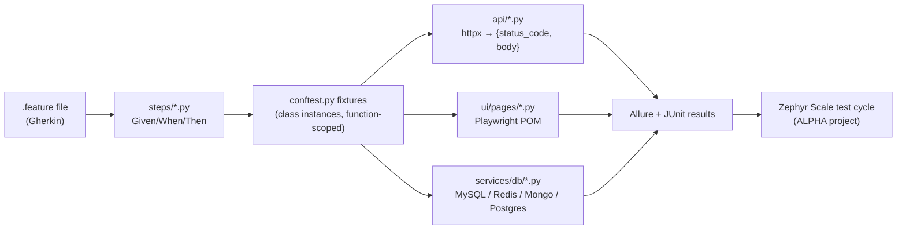

<div align="center">

# Platform QA Automation

**Pure pytest-bdd + Playwright test suite for Platform UAT — API, UI, and data-layer coverage in one framework.**


</div>

---

## What this is

A living, Gherkin-driven regression suite for Platform's UAT environment — one Python
framework covering REST API calls, database assertions, and Playwright UI flows, with
every scenario traceable back to a Zephyr Scale test case in Jira.

It replaced a Robot Framework + Selenium suite. That migration is finished: there is no
Robot, `pabot`, or Selenium left in this repo — see [`docs/framework/`](docs/framework/)
if you want the history.

| | |
|---|---|
| **Runner** | pytest + pytest-bdd (`.feature` files are the source of truth) |
| **API layer** | httpx, thin clients → `{status_code, body}` |
| **UI layer** | Playwright (native Python), Page Object Model |
| **Data layer** | MySQL, Redis, MongoDB, PostgreSQL clients, all fixture-scoped |
| **Parallelism** | pytest-xdist (`-n auto --dist loadgroup`), fixture-only state — no module globals, ever |
| **Reporting** | Allure + JUnit XML, auto-attached screenshots/traces on UI failure |
| **Traceability** | Zephyr Scale — default Jira project `ALPHA`; other boards pass `--project` (e.g. `KYC`, `SET`) — `scripts/zephyr_sync.py` |

## Table of contents

- [Quick start](#quick-start)
- [Configuration & secrets](#configuration--secrets)
- [Running tests](#running-tests)
- [Tags — required axes](#tags--required-axes)
- [Project layout](#project-layout)
- [How the pieces fit together](#how-the-pieces-fit-together)
- [Adding a test](#adding-a-test)
- [Reporting](#reporting)
- [Zephyr Scale sync](#zephyr-scale-sync)
- [Figma (AI / MCP)](#figma-ai--mcp)
- [Dev tooling](#dev-tooling)
- [CI & Docker](#ci--docker)
- [Known ops gaps](#known-ops-gaps)
- [Branch names](#branch-names)
- [Contributing](#contributing)

---

## Quick start

**Prerequisites**

- Python **3.10 or 3.11** (3.12+ is not supported — `pydantic`/`playwright` pins in
  `pyproject.toml` cap it)
- VPN / network access to Platform UAT, MySQL, and Redis (Mongo/Postgres only for suites
  that touch them)
- Chromium, for UI (`e2e`) scenarios — installed via Playwright below

```bash
python3.11 -m venv .venv
source .venv/bin/activate          # Windows: .venv\Scripts\activate

pip install -e ".[dev]"            # project deps + ruff + pre-commit
pre-commit install                 # lint/format/secrets guard on every commit
make browsers                      # Chromium via Platform proxy (cdn.playwright.dev is geo-blocked)
```

Or, equivalently:

```bash
make install-dev
make browsers
```

Internal Platform mirrors (recommended on the corporate network):

```bash
pip install --index-url https://example.com/simple -e ".[dev]"
PLAYWRIGHT_DOWNLOAD_HOST=https://example.com/raw-playwright-proxy/ playwright install chromium
```

Sanity-check the install — this should list every scenario without running anything:

```bash
make collect
# or: PYTHONPATH=. pytest --collect-only -q

make steps-audit   # runtime step-binding check (IDE "undefined step" squiggles are not this)
```

## Configuration & secrets

| What | Where | Committed? |
|------|-------|------------|
| Stage environment (URLs, MS paths, DB hosts) | `config/environment-stage.yaml` | ✅ yes |
| Shared constants | `data/CONSTANTS.yaml` | ✅ yes |
| Secret **templates** | `secrets/*.example.yaml`, `secrets/*.example.env` | ✅ yes |
| Real secrets | copy examples → `secrets/uat_telephone_bills.yaml`, `secrets/uat_promissory_note.yaml`, `secrets/uat_wealth.yaml`, `secrets/jira_atm.env`, `secrets/figma.env` | ❌ never |

Settings load through `pydantic-settings` (`tests/config/settings.py`). CI injects real
credentials as protected variables — never as committed files. The pre-commit hook
`no-real-secrets` refuses to let a non-`*.example.*` file under `secrets/` be staged, as
a second line of defense on top of `.gitignore`.

## Running tests

```bash
export PYTHONPATH=.

# Smoke — the fast, must-be-green gate
pytest -m "smoke and api" -v

# One domain
pytest -m wallet -v

# Promissory note slice (all kyc promissory features)
pytest -m kyc_promissory -v

# One feature, by its unique marker
pytest -m "platform_ui_hub or bill_tci_ui" -v

# Parallel — ``xdist_group`` only works with ``--dist loadgroup`` (debit pins live routing)
pytest -n auto --dist loadgroup -m "api and not e2e" -v

# Run only specific Zephyr test cases
pytest --zephyr-keys=ALPHA-T1234,ALPHA-T5678 -v

# Live Gherkin in the terminal (Feature / Scenario / steps) — API and UI
# Use -vv with the reporter so Given/When/Then lines appear (plain -v only shows Scenario).
pytest -m "smoke and api" -vv --gherkin-terminal-reporter

# Watch a UI run live (local debug only — see below)
pytest -m e2e --headed --slow-mo 250 -vv --gherkin-terminal-reporter
```

Or the short version, via `Makefile`:

```bash
make smoke        # smoke and api (+ Gherkin terminal lines + allure-report/)
make regression   # api and regression (+ Gherkin terminal lines + allure-report/)
make ui           # e2e and smoke (+ Gherkin terminal lines + allure-report/)
make ui-debug     # same as ui, headed + slow-mo 250 (local only)
make allure-generate  # rebuild HTML from existing allure-results/
make allure-serve     # interactive HTML server from allure-results/
```

UI scenarios need Chromium + UAT reachability, and usually MySQL/Redis for OTP and user
factories. Intermittent UAT `nginx 502`s are infrastructure flakes — retry before
suspecting the test.

**Live terminal vs rich report**

| Layer | How | What you see |
|-------|-----|----------------|
| Terminal | `-vv --gherkin-terminal-reporter` (also on `make smoke` / `ui` / …) | Feature, Scenario, Given/When/Then (API + UI) |
| Allure HTML | auto-built to `allure-report/` after `make smoke`/`ui`/… (needs Allure CLI) | Open `allure-report/index.html` — steps, asserts, screenshots/traces |
| Allure raw | always written to `allure-results/` by pytest | Input for `make allure-generate` / CI |

CI keeps Allure + JUnit artifacts. Set CI/CD variable `ALLURE_IMAGE` so the **Allure HTML Report** job publishes browsable `allure-report/` (same as local). Optional: `ENABLE_GITLAB_PAGES=true` for hosted Pages.

**UI debug flags (local only)** — pytest options wired in `tests/conftest.py` → Playwright:

| Flag | What it does |
|------|----------------|
| `--headed` | Open a real Chrome window instead of headless |
| `--slow-mo MS` | Pause `MS` milliseconds before each Playwright action (click, fill, …) so you can follow the flow |
| `--gherkin-terminal-reporter` | Print Gherkin Feature/Scenario/steps live (pytest-bdd; works for API too). Pair with **`-vv`** so steps show |

Example: `--headed --slow-mo 250 -vv --gherkin-terminal-reporter`. These are for watching a run on your machine. CI / default pipeline leave headed/slow-mo unset (`slow_mo=0`, headless) so runs stay fast.

## Tags — required axes

Every scenario must resolve to **story** (`@PROJECT-####`) + **severity** + **type** +
**suite** + **domain** + **feature** (`{domain}_{capability}`). Prefer shared story /
type / suite / domain / feature once above `Feature:`; put behavior and severity on
scenarios when they differ. This is enforced, not a suggestion — see
[`.cursor/rules/gherkin-style.mdc`](.cursor/rules/gherkin-style.mdc) and [`AGENTS.md`](AGENTS.md).

| Axis | Values | Purpose |
|------|--------|---------|
| `story` | `@PROJECT-####` for that team's Jira board (e.g. `@KYC-2050`; **not** `@…-T…`) | Zephyr/Jira issueLinks |
| `severity` | `high` / `medium` / `low` | risk-based run selection |
| `type` | `api` / `e2e` | split fast API runs from slower browser runs |
| `suite` | `smoke` / `regression` | deploy gate vs. full nightly coverage |
| `domain` | `platform` / `wallet` / `payment` / `bill` / … | ownership & targeted reruns |
| `feature` | `{domain}_{capability}`, e.g. `wallet_transfer` | one unique tag per `.feature` file |

Full registered marker list: [`pyproject.toml`](pyproject.toml) (`[tool.pytest.ini_options]`).

## Project layout

```text
tests/
├── api/               # thin httpx clients, one module per endpoint — {status_code, body}
│   ├── bill_mng/  nemo/  payment/  purchase_mng/  switch_psp/  tci/  tgs/  uaa/  …
├── bdd/
│   ├── features/      # Gherkin — organized by domain (bill/, payment/, platform/, wallet/)
│   └── steps/         # thin Given/When/Then orchestration — no raw HTTP, no CSS selectors
├── config/            # Settings (pydantic-settings), constants, payment data loaders
├── services/          # factories, auth, wallet lifecycle, DB clients, purchase orchestration
│   └── db/            # MySQLClient, RedisClient, MongoDbClient, PostgresClient
├── ui/                # Playwright browser session + auth
│   └── pages/         # Page Object Model — BasePage + app/ + dashboard/
├── unit/              # pure unit tests (rounding, local-env checks, …)
└── conftest.py        # every fixture lives here — nothing is a module-level singleton

config/                # environment-stage.yaml
data/                  # CONSTANTS.yaml + wallet/payment/app domain fixtures
secrets/               # *.example.* only — real files are gitignored
scripts/               # zephyr_sync.py, jira_local_env.py, scripts/bill_mng/…
docs/
├── framework/         # steady-state framework docs — start at STATUS.md
├── ai/                # AI workflow + onboarding prompt
├── bill-mng-sdet/     # bill-mng domain guidance book + Postman
└── zephyr/            # Zephyr Scale guide + ATM Postman collection
.cursor/               # AI agent rules & skills (Cursor / Claude)
```

## How the pieces fit together



Every arrow in that diagram only ever goes through a **pytest fixture** — no HTTP client,
DB connection, or factory is ever a module-level global. That's what makes `pytest -n
auto` safe: each xdist worker gets its own fixture instances, so nothing crosses a
worker boundary.

## Adding a test

1. Prefer `Scenario Outline` + `Examples` over cloned scenarios.
2. New endpoint → `tests/api/{team}/{endpoint}.py`, returning `{status_code, body}`.
3. New UI page → follow [`docs/framework/ui-pom-cookbook.md`](docs/framework/ui-pom-cookbook.md).
4. Wire any new class through a fixture in `tests/conftest.py` — never a module-level client.
5. One MR = one unit: one API module, one feature file, or one platform piece.

Full layer rules: [`.cursor/rules/pytest-architecture.mdc`](.cursor/rules/pytest-architecture.mdc).
Human-facing setup + PR checklist: [`CONTRIBUTING.md`](CONTRIBUTING.md).

## Reporting

| Where | What you get |
|-------|----------------|
| **GitLab → job → Tests** | JUnit pass/fail (MR / pipeline) |
| **GitLab → Allure Results** | Raw `allure-results/` artifact |
| **GitLab → Allure HTML Report** | Static `allure-report/` (needs `ALLURE_IMAGE`) — open `index.html` |
| **Local Allure HTML** | `allure-report/index.html` after `make smoke` / `ui` / … |
| **GitLab Pages** (optional) | Hosted Allure HTML — enable after admin turns Pages on |

**Local**

```bash
make smoke                 # writes allure-results/ + report.xml + allure-report/
open allure-report/index.html   # or double-click in Finder
# optional live server:
make allure-serve
```

Plain `pytest …` still writes `allure-results/` only; then run `make allure-generate` (or `make allure-report` to generate + open).

**Plain-text pass/fail/error report (no Allure CLI needed)**

Every run writes two plain-text files under `allure-results/`, independent of the HTML report:

| File | What it is |
|------|------------|
| `allure-results/summary.log` | End-of-run roll-up — pass/fail/error/skip counts + one line per non-passing test (written by `pytest_terminal_summary` in `tests/conftest.py`) |
| `allure-results/pytest.log` | Every `AssertionReport` / `assert_*` check (`tests/services/assert_report.py`) as a `[PASS]` / `[FAIL]` / `[ERROR]` log line, in call order |

`FAIL` means a check ran and the value was wrong (product defect); `ERROR` means the check
itself couldn't run (exception, missing precondition, connectivity). Watch checks live with
`--log-cli-level=INFO`.

**From a CI pipeline**

1. Open the pipeline → **Pytest Smoke API** / **Allure Results** / **Allure HTML Report**
2. **Tests** tab → JUnit summary
3. **Browse** / **Download** artifacts:
   - `allure-results/` — always (when the smoke job ran)
   - `allure-report/` — when `ALLURE_IMAGE` is set (open `index.html` in a browser)
4. If you only have raw results, unzip and run:

```bash
allure serve path/to/allure-results
# or: allure generate path/to/allure-results --clean -o allure-report
```

UI failures attach screenshot + Playwright trace into Allure when e2e jobs run.

**CI variables for HTML**

- `ALLURE_IMAGE` = Platform OCI image that contains the `allure` CLI → enables **Allure HTML Report** artifacts
- `ENABLE_GITLAB_PAGES=true` (+ `ALLURE_IMAGE`) → optional hosted Pages site

Until `ALLURE_IMAGE` is set, CI still keeps raw `allure-results/` for download.

## Zephyr Scale sync

`.feature` files are the living test-case documentation — `scripts/zephyr_sync.py` keeps
them in sync with Zephyr Scale, and `tests/zephyr_result_collector.py` pushes a pytest run's
Pass/Fail/Blocked results into a new Zephyr test cycle.

The script defaults to Jira project `ALPHA` (wallet, app, login, …). KYC, SET, and other
boards use their own key:

```bash
python scripts/zephyr_sync.py --help
python scripts/zephyr_sync.py --project KYC
python scripts/zephyr_sync.py --project SET
```

Full guide: [`docs/zephyr/Zephyr-Scale-Complete-Guide.pdf`](docs/zephyr/Zephyr-Scale-Complete-Guide.pdf) ·
Agent workflow: [`.cursor/skills/zephyr/SKILL.md`](.cursor/skills/zephyr/SKILL.md)

## Figma (AI / MCP)

Paste a QA Figma token once (gitignored), then Cursor **and** Claude Code can read
design frames. Template: `secrets/figma.example.env` → `secrets/figma.env`.

Full steps: [`docs/ai/figma-setup.md`](docs/ai/figma-setup.md) ·
Agent workflow: [`.cursor/skills/figma/SKILL.md`](.cursor/skills/figma/SKILL.md)

## Dev tooling

| Tool | Config | Command |
|------|--------|---------|
| Lint / format | `[tool.ruff]` in `pyproject.toml` | `make lint` · `make format` |
| Typecheck | `[tool.basedpyright]` — `scripts/` + `tests/` | `make typecheck` (also a pre-commit hook) |
| Pre-commit hooks | `.pre-commit-config.yaml` | `pre-commit install` (once), then automatic |
| Common tasks | `Makefile` | `make install-dev`, `make smoke`, `make collect`, `make steps-audit`, … |
| Editor defaults | `.editorconfig` | automatic in any editor that reads it |

`make typecheck` runs **basedpyright** (errors only) so IDE Problems like incompatible
method overrides fail locally and on commit. Re-install dev deps if needed:
`pip install -e ".[dev]"`.

## CI & Docker

GitLab CI (see [`.gitlab-ci.yml`](.gitlab-ci.yml)) runs: **Branch name convention** on
feature branches/MRs, **Pytest Smoke API** on every MR/default-branch push (API install
only — no Playwright; JUnit + Allure results), **Allure Results** packaging job,
**Pytest Regression API** / **Pytest UI Smoke** scheduled or manual. Optional **pages**
job waits until Pages + `ALLURE_IMAGE` are configured (see [Reporting](#reporting)).

```bash
docker build -f Dockerfile -t platform-pytest .
docker run --rm platform-pytest pytest -m "smoke and api" -v
```

## Known ops gaps

Platform / Company **business login** credentials committed in
`config/environment-stage.yaml` are currently rejected by live UAT. `payment_health_check`
and `payment_refund_inquiry` stay red until ops refreshes them — this is a credentials
issue, not a code defect (verified with a raw `httpx` call bypassing all framework code).

## Branch names

CI rejects MRs whose branch name does not match:

- **Ticketed:** `feat|fix|chore|hotfix|docs/<JIRA-KEY>-<number>-<slug>`
  - e.g. `feat/ALPHA-1234-bill-inquiry-tests`
- **No ticket:** `chore|hotfix|docs/<team>-<slug>` (any lowercase team)
  - e.g. `chore/infra-upgrade-ci-runners`

`feat` / `fix` require a Jira key (UPPERCASE). Use hyphens, not underscores.

## Contributing

Start with [`CONTRIBUTING.md`](CONTRIBUTING.md) for the human-facing checklist, or
[`AGENTS.md`](AGENTS.md) + [`docs/framework/STATUS.md`](docs/framework/STATUS.md)
if you're an AI agent picking up work here.

---

<div align="center">

Licensed under [BSD 2-Clause](LICENSE).

</div>
